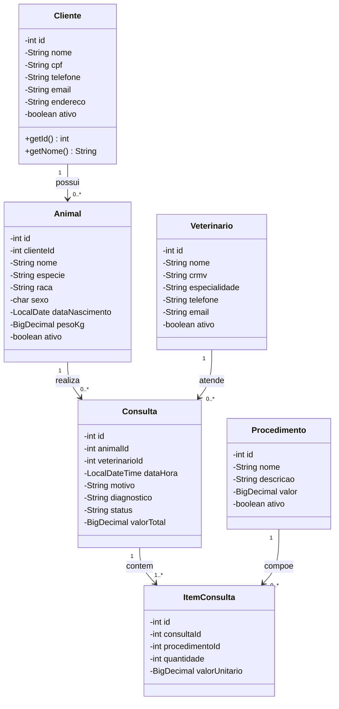
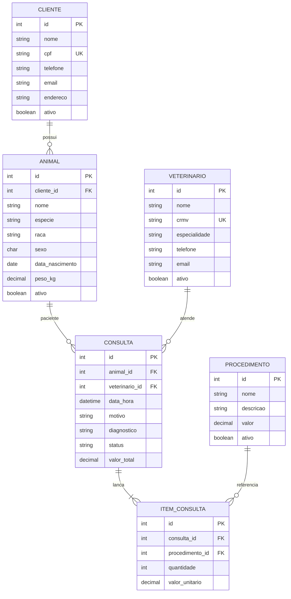

# VetCare — Sistema de Gestão de Clínica Veterinária

Sistema desktop em **Java Swing**, organizado no padrão **MVC**, com persistência em banco relacional (MySQL/MariaDB). Esta entrega cobre a **1ª etapa**: tema, protótipos de tela, diagrama de classes das entidades e modelo entidade-relacionamento.

## Tema

O VetCare apoia a rotina de uma clínica veterinária de pequeno porte:

- cadastro de tutores (clientes) e dos animais;
- cadastro de veterinários e do catálogo de procedimentos;
- agendamento e registro de consultas, com itens (procedimentos realizados) e valor total.

O domínio foi escolhido porque exige várias telas, relacionamentos 1:N e N:N (resolvido por tabela associativa) e operações de inclusão, alteração, consulta e inativação — o suficiente para demonstrar MVC com acesso a dados.

## Tabelas

| Tabela | Papel |
|---|---|
| `cliente` | Tutor do animal |
| `animal` | Paciente, vinculado a um cliente |
| `veterinario` | Profissional responsável pela consulta |
| `procedimento` | Serviço do catálogo, com preço |
| `consulta` | Atendimento (animal + veterinário + status) |
| `item_consulta` | Procedimentos lançados em uma consulta |

São 6 tabelas. As cinco primeiras são entidades de negócio; `item_consulta` materializa o relacionamento N:N entre consulta e procedimento e guarda quantidade e valor praticado.

## Protótipos de tela

Abra o arquivo estático (não depende de servidor):

- [docs/prototipos/index.html](docs/prototipos/index.html)

Telas previstas na view:

1. Login
2. Painel principal
3. Clientes (lista + formulário)
4. Animais (lista + formulário, com tutor)
5. Veterinários
6. Consultas (cabeçalho + itens)
7. Procedimentos (catálogo)

## Diagrama de classes (entidades)

Pacote `br.edu.vetcare.model`. Os DAOs e controllers não fazem parte deste diagrama de domínio.



## Modelo entidade-relacionamento (MER)



Cardinalidades:

- um cliente possui zero ou mais animais;
- um animal realiza zero ou mais consultas;
- um veterinário atende zero ou mais consultas;
- uma consulta lança um ou mais itens;
- um procedimento pode aparecer em zero ou mais itens.

Script correspondente: [sql/schema.sql](sql/schema.sql).

## Organização MVC (prevista na implementação)

```
br.edu.vetcare
├── model        entidades e regras simples de domínio
├── dao          acesso JDBC (uma classe por tabela)
├── controller   media view e dao, sem SQL na tela
├── view         telas Swing (JFrame / JDialog / JPanel)
└── util         conexão e exceções
```

A view não acessa o banco. O controller recebe eventos da tela, valida e chama o DAO. O DAO só persiste e recupera entidades.

