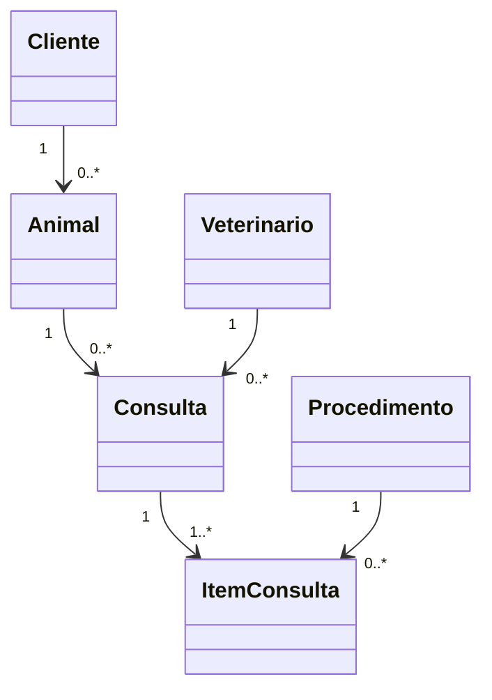
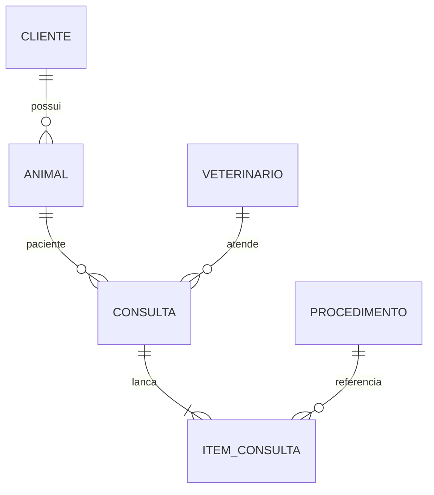

# VetCare — Sistema de Gestão de Clínica Veterinária

Sistema desktop em **Java Swing**, padrão **MVC**, com persistência JDBC. O banco padrão é H2 em arquivo (abre sem instalar servidor). O script em `sql/schema.sql` também serve para MySQL.

## Tema

Rotina de uma clínica veterinária: tutores, animais, veterinários, catálogo de procedimentos e consultas com itens e valor total.


São 6 tabelas. As cinco primeiras são entidades de negócio; `item_consulta` materializa o relacionamento N:N entre consulta e procedimento e guarda quantidade e valor praticado.

Login inicial:

| Usuário | Senha |
|---|---|
| admin | admin |
| recepcao | 1234 |

O arquivo do banco é criado em `data/vetcare`. Para MySQL, ajuste `src/main/resources/db.properties`, execute `sql/schema.sql` e troque o driver em `lib/`.

## Telas

1. Login
2. Painel do dia
3. Clientes
4. Animais
5. Veterinários
6. Procedimentos
7. Consultas (cabeçalho + itens, em transação)

Protótipos da 1ª etapa: [docs/prototipos/index.html](docs/prototipos/index.html)

## Tabelas

| Tabela | Papel |
|---|---|
| `usuario` | Login da recepção |
| `cliente` | Tutor |
| `animal` | Paciente (N:1 com cliente) |
| `veterinario` | Profissional (CRMV único) |
| `procedimento` | Serviço com preço |
| `consulta` | Atendimento |
| `item_consulta` | N:N consulta–procedimento, com quantidade e valor |

## Diagrama de classes



## MER



## MVC

```
br.edu.vetcare
├── App              inicia o banco e a tela de login
├── model            entidades
├── dao              JDBC, uma classe por tabela
├── controller       validação e chamada ao DAO
├── view             telas Swing
└── util             conexão e exceção de banco
```

A view não executa SQL. O controller valida e chama o DAO. A gravação da consulta e dos itens ocorre na mesma transação.

